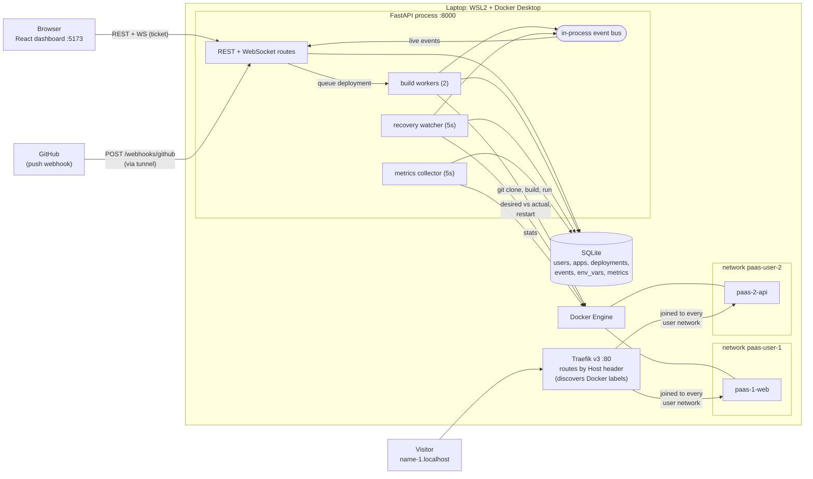

# Hostra

A self-hosted mini PaaS (think a tiny Vercel / Render / Railway) that runs on a laptop.
Paste a GitHub URL, and Hostra clones it, builds the Dockerfile, runs the container with
resource limits on an isolated network, gives it a subdomain, keeps it alive, and streams
its build log, runtime logs and metrics to a live dashboard.

> Screenshots: `docs/screenshots/projects.png`, `docs/screenshots/build-log.png`,
> `docs/screenshots/metrics.png` · Demo GIF: `docs/screenshots/demo.gif` *(placeholders: add your own)*

## Features

- **Git-to-URL deploys**: `https://github.com/owner/repo` → `http://<name>-<userid>.localhost`
- **Deployments as objects**: queued → building → live / failed, with commit, trigger, duration
  and a **live build log** over WebSocket. Deploys return immediately (202); a worker pool builds.
- **Safe swaps**: the new container must survive a startup check before it replaces the old one.
  A failed build or a crashing release leaves the previous version serving. Measured: 0 failed
  requests out of 101 during a redeploy.
- **Auto-recovery**: a reconciliation loop restarts exited/unhealthy containers, with
  **crash-loop protection** (more than 5 restarts in 5 minutes → `failed`, stop retrying).
- **Live everything**: authenticated WebSockets for runtime logs, build logs and a per-user
  event feed. The dashboard updates the instant a container dies or a deploy finishes.
- **Metrics**: CPU, memory, network rates and disk usage per app, 1 hour of history.
- **Environment variables**: encrypted at rest (Fernet), masked, explicit reveal, `.env` paste,
  "redeploy to apply" banner.
- **GitHub webhooks**: push-to-deploy with HMAC-SHA256 verification and per-app secrets.
- **Multi-tenant**: per-user accounts, per-user Docker networks (apps of different users cannot
  reach each other), 404 (not 403) for anything you do not own.
- **Hardening**: 512 MB / 0.5 CPU / 256 pids / no-new-privileges per container, strict input
  validation, rate limits, clone and build timeouts, bounded build concurrency.

## Architecture



### What happens on a deploy

1. `POST /deploy` validates the input, stores the app + env vars, inserts a `queued`
   deployment and returns **202** with its id. The browser opens the build log page.
2. A worker thread picks the id from the queue (max 2 builds at once, one per app).
3. `git clone --depth 1 -- <url>` (timeout 120s), read commit sha/message, detect the port from
   the first `EXPOSE` (or the user's override, else 8000).
4. `client.api.build(decode=True)` streams every build line into
   `logs/deployments/<id>.log` and onto the event bus → WebSocket → browser.
5. Start `paas-<slug>-next` on the owner's network with limits, env vars and Traefik labels.
   It must still be running after 3s, otherwise it is removed and the deployment fails
   (the old container never stopped).
6. Remove the old container, rename `-next` → `paas-<slug>`, mark the deployment `live`.

### What happens on a request

1. `http://web-1.localhost` resolves to 127.0.0.1 (browsers resolve `*.localhost` themselves).
2. Traefik on port 80 matches the router rule ``Host(`web-1.localhost`)``. It learned that rule
   from the container's labels through the Docker socket; no config file was edited.
3. Traefik forwards over the user's network (`traefik.docker.network=paas-user-1`) to the
   container port from the `loadbalancer.server.port` label, retrying on connection errors.

More on the why: [docs/ARCHITECTURE.md](docs/ARCHITECTURE.md).

## Tech stack

| Layer | Choice | Why |
|---|---|---|
| API | FastAPI, Uvicorn | async WebSockets + simple sync handlers in a threadpool |
| Data | SQLite + SQLAlchemy 2 (WAL mode) | zero setup; idempotent startup migration, no Alembic |
| Auth | bcrypt, PyJWT, one-time WS tickets | standard password hashing, stateless tokens |
| Crypto | `cryptography` Fernet + HKDF | env vars encrypted at rest |
| Containers | Docker SDK for Python | build, run, stats, logs |
| Routing | Traefik v3 | label-based discovery, no reloads |
| Frontend | React 19, Vite, react-router, Tailwind v4 | |
| UI bits | lucide-react, recharts, sonner | icons, charts, toasts |

## Quick start (Windows + WSL2)

Prerequisites: WSL2 Ubuntu, Docker Desktop with WSL integration enabled, Python 3.12+,
Node 20+ (nvm), `make` (`sudo apt install make`).

```bash
cd ~/paas-project

# 1. config
cp backend/.env.example backend/.env
python3 -c "import secrets; print(secrets.token_urlsafe(48))"   # -> PAAS_SECRET_KEY
python3 -c "import secrets; print(secrets.token_hex(32))"       # -> GITHUB_WEBHOOK_SECRET
# paste both into backend/.env

# 2. dependencies (once)
python3 -m venv backend/venv && backend/venv/bin/pip install -r backend/requirements.txt
(cd frontend && npm install)

# 3. run (three terminals)
make up             # Traefik on :80 (dashboard on :8080)
make dev-backend    # API on :8000 (docs at /docs)
make dev-frontend   # dashboard on :5173

# 4. optional demo data: user demo@example.com / hostra-demo + 3 sample apps
make seed
```

Open http://localhost:5173, sign up, click **New Project** and paste e.g.
`https://github.com/jeffreysolomon123/hello-flask`.

If port 80 or 8080 is taken, change the left side of the `ports:` mapping in
`docker-compose.yml` (for example `"8081:80"`) and open apps as `http://web-1.localhost:8081`.

## Configuration

`backend/.env` (never committed; see `backend/.env.example`):

| Variable | Default | Meaning |
|---|---|---|
| `PAAS_SECRET_KEY` | *(required, ≥ 32 bytes)* | signs JWTs + WS tickets, derives the env-var encryption key. Changing it logs everyone out and makes stored env vars unreadable. |
| `DOMAIN` | `localhost` | apps are served at `<name>-<userid>.<DOMAIN>` |
| `FRONTEND_ORIGIN` | `http://localhost:5173` | allowed CORS origin |
| `GITHUB_WEBHOOK_SECRET` | *(empty = webhooks off)* | master secret; per-app webhook secrets are derived from it |
| `PUBLIC_API_URL` | `http://localhost:8000` | shown as the webhook Payload URL (set it to your tunnel URL) |

`frontend/.env.local`: `VITE_API_URL=http://localhost:8000`.

## Push-to-deploy from GitHub (local tunnel)

GitHub cannot call `localhost`, so expose the API with a tunnel:

**Cloudflare Tunnel (recommended)**: no account needed for a quick tunnel.

```bash
cloudflared tunnel --url http://localhost:8000
# -> https://<random>.trycloudflare.com ; put it in PUBLIC_API_URL and restart the API
```

Then in the project's **Settings** tab, turn on **Auto-deploy**, and copy the Payload URL and
Secret into GitHub → repo → Settings → Webhooks (content type `application/json`, push events).

**smee.io** also works for testing (`npx smee-client --url https://smee.io/<id> --target
http://localhost:8000/webhooks/github`), but smee re-serializes the JSON body, which can break
the byte-exact HMAC signature check. Cloudflare Tunnel forwards the original bytes.

## Tests

End-to-end tests run against the real stack (API, Docker, Traefik); they create the users
`alice@example.com` and `bob@example.com`:

```bash
cd backend
./venv/bin/python ../tests/e2e_api.py         # deploy, routing, limits, isolation, env, recovery,
                                              # crash loop, failed build, webhook, metrics, rate limit
./venv/bin/python ../tests/e2e_websockets.py  # tickets, ownership, build/log/event streams
```

## Limitations and future work

- **Untrusted code builds on the host's Docker daemon.** Containers have limits and
  `no-new-privileges`, but `docker build` of a hostile Dockerfile and a shared kernel are not a
  real sandbox. Production needs gVisor / Kata / Firecracker microVMs and rootless BuildKit in
  a separate build cluster.
- **Single process, single node.** The event bus, rate limiter, WS ticket store and build queue
  are in memory. Scaling out means Redis (pub/sub, rate limits), a real job queue, and Postgres
  instead of SQLite.
- **Metrics** are home-grown polling (≈ 1-2s per `stats` call, parallelized). At scale use
  cAdvisor + Prometheus + Grafana.
- **No HTTPS.** Add Let's Encrypt via Traefik's ACME resolver on a real domain, or mkcert locally.
- **Redeploy swap gap**: when a redeploy *changes* the container port (or the Traefik labels),
  Traefik sees two conflicting router definitions for ~3s and returns 404 during the swap.
- **Apps can still reach the host**: per-user networks block app-to-app traffic, but containers
  can reach the internet and `host.docker.internal` (the API itself). Egress firewalling is
  future work.
- **Builds use the classic Docker builder** through the API (no BuildKit cache mounts).
- Only public GitHub repos with a root `Dockerfile`; no buildpacks, no private repo auth, no
  rollbacks to a previous image, no custom domains, one container per app (no scaling).
