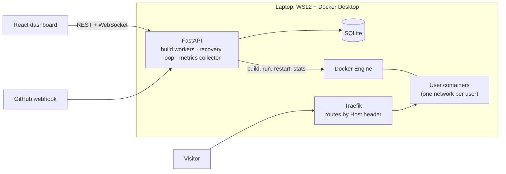

# Hostra

**Paste a GitHub URL, get a live app.** A self-hosted mini PaaS (think Vercel / Render) that runs on a laptop.

[▶ Watch the demo](https://www.youtube.com/watch?v=xRNhQeWchMo) · [Architecture notes](docs/ARCHITECTURE.md)


Hostra clones a repo, builds its Dockerfile, runs it in a resource-limited container on an isolated network, gives it a subdomain, keeps it alive, and streams logs and metrics to a live dashboard.

## Highlights

- **Git-to-URL deploys:** `github.com/owner/repo` → `http://<name>-<userid>.localhost`
- **Live build logs:** deploys return instantly (202), a worker pool builds, logs stream over WebSocket
- **Zero-downtime swaps:** the new container must pass a startup check before replacing the old one (0 failed requests out of 101 during a redeploy)
- **Auto-recovery:** a reconciliation loop restarts crashed containers, with crash-loop protection (5 restarts in 5 min → `failed`)
- **Metrics:** per-app CPU, memory, network and disk, with 1 hour of history
- **Push-to-deploy:** GitHub webhooks with HMAC-SHA256 verification
- **Encrypted env vars:** Fernet encryption at rest, masked in the UI
- **Multi-tenant:** per-user accounts and Docker networks, so users can't reach each other's apps
- **Hardened containers:** 512 MB / 0.5 CPU / 256 pids / no-new-privileges, rate limits, build timeouts

## Architecture



**Deploy flow:** validate → queue (202) → `git clone` → `docker build` (streamed) → start new container → startup check → swap out old container → `live`

## Tech stack

FastAPI · SQLAlchemy + SQLite · Docker SDK · Traefik v3 · React 19 · Vite · Tailwind v4 · JWT + bcrypt · Fernet

## Quick start (Windows + WSL2)

Requires WSL2 Ubuntu, Docker Desktop, Python 3.12+, Node 20+, `make`.

```bash
cp backend/.env.example backend/.env
# set PAAS_SECRET_KEY (python3 -c "import secrets; print(secrets.token_urlsafe(48))")

python3 -m venv backend/venv && backend/venv/bin/pip install -r backend/requirements.txt
(cd frontend && npm install)

make up             # Traefik on :80
make dev-backend    # API on :8000
make dev-frontend   # dashboard on :5173
```

Open http://localhost:5173, sign up, click **New Project**, and paste a public repo with a root `Dockerfile`.

## Tests

End-to-end tests run against the real stack (Docker + Traefik):

```bash
cd backend
./venv/bin/python ../tests/e2e_api.py
./venv/bin/python ../tests/e2e_websockets.py
```

## Limitations

- Builds untrusted code on the host's Docker daemon, so it's not a real sandbox. Production needs gVisor/Firecracker and a separate build cluster.
- Single node, single process (in-memory event bus and queue). Scaling means Redis, a job queue and Postgres.
- No HTTPS yet (Traefik ACME would add it on a real domain).
- Public GitHub repos with a root `Dockerfile` only. No rollbacks, custom domains or scaling.
